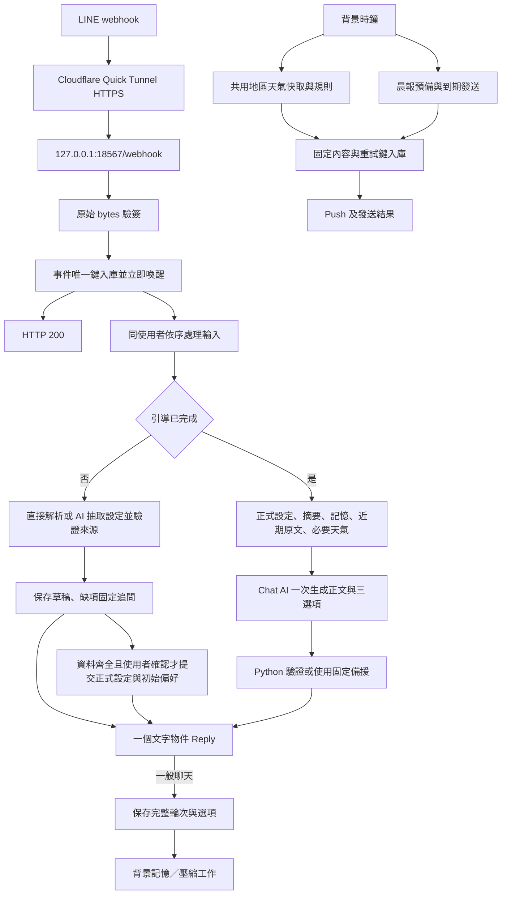

# LINE 天氣與角色聊天：實作架構與驗證

更新：2026-10-21。需求依據：[LINE_Weather_Galgame_Bot_Plan.md](LINE_Weather_Galgame_Bot_Plan.md)。

目前已由原本的固定時間推播腳本，改為單一 FastAPI 程序、獨立聊天／背景工作流程與 SQLite。第一版支援臺北市、新北市行政區；其他縣市尚未加入資料集對照。本機已透過 Quick Tunnel 公開 HTTPS，完成 LINE 官方 webhook 與重啟驗證；沒有發送人工測試訊息，手機收訊仍待使用者實測。

## 檔案配置

```text
Line-test/
├─ .github/workflows/ci.yml        # PR／push 穩定測試；可信分支手動真實驗證
├─ .env.example                   # 必要金鑰、SQLite 路徑、帳號月額度
├─ scripts/install_cloudflared.ps1 # 官方固定版本下載與 SHA-256 校驗
├─ .tools/cloudflared.exe          # 本機執行檔，忽略版控
├─ pyproject.toml / uv.lock       # Python 3.11+；CI 使用 Python 3.12
├─ src/weather_bot/
│  ├─ main.py                     # FastAPI lifespan、/webhook、/health、唯一啟動入口
│  ├─ onboarding.py               # 設定抽取、來源查核、草稿、固定提示與確認提交
│  ├─ tunnel.py                   # 本機隧道、公開驗簽探測、LINE webhook 同步與退出恢復
│  ├─ config.py                   # 設定、Asia/Taipei、可替換時鐘
│  ├─ schemas.py                  # 句數、三選項、記憶更新及摘要契約
│  ├─ db.py                       # 七張資料表、短交易、重啟恢復
│  ├─ controller.py               # 事件接收、固定設定、選項解析、聊天期限
│  ├─ line_io.py                  # 驗簽、單則訊息、Reply／Push、官方額度查詢
│  ├─ weather.py                  # CWA adapter、時間對齊、雜湊、降雨候選
│  ├─ ai.py                       # 非同步 BIRC adapter、JSON Schema、關閉 thinking
│  ├─ chat.py                     # 角色規則、上下文、天氣事實及備援
│  ├─ memory.py                   # 記憶來源／版本、忘記、摘要交易
│  ├─ workers.py                  # 即時聊天、背景排程、晨報、提醒、outbox 重試
│  └─ ai_summary.py               # 原有同步 adapter 與既有契約測試保留
├─ tests/
│  ├─ conftest.py                 # logs/ci 下隔離 SQLite、固定時鐘、外部替身、CI 證據
│  ├─ fixtures/cwa_township.json  # 固定的現行 CWA JSON 結構；溫度刻意反序
│  ├─ test_ai_summary.py          # 原有 adapter 回歸
│  ├─ test_ai.py                  # JSON Schema、來源 ID、錯誤輸出
│  ├─ test_weather.py             # T01、缺值、同版零 AI、夜間、額度
│  ├─ test_briefing.py            # T02、六句、準備／發送、當日去重
│  ├─ test_chat.py                # T03、設定、編號、自由文字、舊選項、範圍守門
│  ├─ test_onboarding.py          # 未完成項目固定 Reply、各階段／舊選項／貼圖／逾時
│  ├─ test_onboarding_ai.py       # 自然語句、缺項、確認、初始偏好、來源反例與升級
│  ├─ chat_scenario.py            # 五輪對話與動態接話的共用驗證／可讀報告
│  ├─ test_chat_five_turns.py      # T06 一般 CI：五輪、段落顯示、數字／按鈕還原
│  ├─ test_memory.py              # T04、自然偏好、來源、重啟、隔天使用
│  ├─ test_compaction.py          # T05、19／20 輪、15＋5、交易回滾
│  ├─ test_line_reply.py          # Reply token、慢模型、慢記憶、HTTP、webhook
│  ├─ test_tunnel.py              # 先驗證後同步、失敗不覆寫、快取、退出恢復、停止清理
│  ├─ test_service_startup.py     # Windows 獨占連接埠、重複啟動不進入 Bot／隧道
│  ├─ test_regressions.py         # 獨立審查所發現的邊界
│  ├─ live/test_services.py       # T01–T05 最多八次實際模型請求
│  ├─ live/test_chat_five_turns_live.py # T06 最多五次實際聊天；LINE 永遠 mock
│  └─ live/test_onboarding_live.py # T07 最多三次實際抽取／確認後聊天
├─ bot.sqlite3                    # 正式資料庫，位於專案根目錄，忽略版控
└─ logs/                        # 固定最新產物，忽略版控
   ├─ ci/latest.json             # 每案例狀態、實測 Reply、job／memory／outbox 證據
   ├─ ci/databases/*.sqlite3      # 每案例固定最新資料庫，一般／真實測試共用隔離規則
   ├─ ci/junit.xml               # CI 測試報告
   ├─ live/latest.json           # T01–T05、模型輸入輸出、耗時與失敗分類
   ├─ live/chat_five_turns.md / .json # T06 完整五輪正文、三個 action、耗時與檢查
   ├─ live/onboarding.md / .json   # T07 自然設定、追問、確認與初始偏好使用
   └─ service/                    # latest.json、cloudflared.log、stdout/stderr.log、restart_test.json
```

`sample/opencode.py` 不參與新服務。舊的 `--now` 直接推播路徑與 `line_push.py` 已移除，避免繞過新 outbox。LINE 使用共用 `httpx.AsyncClient` 呼叫官方 HTTP API，無須額外 SDK；原本 APScheduler 也由資料庫到期工作取代。

## 資料與執行邊界



| 資料表 | 實際責任與一致性 |
|---|---|
| `users` | 正式地區、起床時間、三種通知開關；`setup_data` 保存有來源的待確認草稿，最後確認才一起提交 |
| `messages` | 原文在接收時以 `received` 與工作一起提交；聊天送出成功才升為完整輪次，未完成引導不計輪數 |
| `conversation_state` | 摘要、涵蓋位置、記憶游標、有效選項、永久忘記游標 |
| `memories` | 使用者／scope／key 唯一；分類、來源訊息 ID、版本及到期時間 |
| `weather_snapshots` | 各地區正規化預報；雜湊排除抓取時間；可處理 A→B→A 回復 |
| `jobs` | `webhookEventId`／晨報日期／背景批次去重、到期時間、嘗試次數 |
| `outbox` | 待送內容、已讀記憶 ID、已告知降雨、Push 重試鍵及 LINE 接受狀態 |

網路呼叫在交易之外。摘要、涵蓋位置與相關記憶在同一短交易提交。模型格式錯誤、來源不合法或寫入失敗時，游標不前進、原文不刪除。

## Reply token 與一分鐘限制

官方規則為一次使用、收到 webhook 後一分鐘內使用，且應儘快發送：[LINE Reply token](https://developers.line.biz/en/reference/messaging-api/nojs/#reply-token)。本服務以 webhook 抵達時間建立絕對期限：

- 排隊＋天氣查詢＋Chat AI 的處理期限為 25 秒；逾時改用兩句固定備援。
- Reply 整體期限最多 55 秒；過期停止，失敗結果不明時記錄 `uncertain`。
- 不重試一次性 Reply token，也不自動改成 Push；已 claim 的工作重啟後不重送。
- 記憶整理由另一個非同步流程執行，不納入聊天完成時間；同使用者的生成、送出與入庫依序完成。
- CI 的 LINE mock 檢查實際牆鐘耗時及可控制時鐘兩者，拒絕重用與滿 60 秒的 token；另測慢 Memory AI 尚未完成時 Reply 已完成。

mock 可驗證流程及 payload，不能證明 LINE 真正接受某個 Reply token 或手機收訊。本次另外通過 LINE 官方 HTTPS webhook 測試事件；手機收訊與真實 Reply token 仍待人工驗收。

## 天氣、記憶及成本

CWA 同縣市共用快取，排程每小時 `:40` 建立一筆工作。溫度、體感溫度、三小時降雨機率依有效時間對齊；缺值維持 `null`。首次抓取建立基準，相同雜湊不產生提醒；比較未來24小時相同有效時段的天氣現象、氣溫、體感溫度及降雨機率，不把抓取時間、排列或缺值當成天氣變更。

晨報在起床前十分鐘準備，使用對應起床日期與有效預報，起床時發送，最多補送二十分鐘。同日已送出不能重送；尚未嘗試發送的晨報，可因地區／起床時間修改而重新準備。已經嘗試發送但結果不明的內容，保守保留原重試鍵與內容。

快取更新與各使用者的 `weather_change` 工作在同一交易提交，聊天查詢也不會消耗尚未通知的變更。不同事件不受每日一次限制；同一工作透過 outbox business key 與 LINE retry key 去重。夜間時窗為23:30至05:30，夜間關閉或尚未起床時保留待處理工作；起床後合併仍有效的最新差異，已回復原值或已過期的不補發。晨報僅能消除正文實際告知的欄位及時段，不能把整份快取視為已告知。額度不足保留待處理原因；建立前查官方用量並保留本月剩餘晨報預算。發送及重試時重查地區、通知與清醒設定；AI 失敗改用固定天氣事實回覆。

自然偏好於五輪或閒置兩分鐘整理；明確記住／更正／角色調整立即排入工作。`user_id` 由程式綁定，模型不能指定其他使用者；來源 ID 在模型 JSON Schema 中限為當批使用者訊息，Python 再次查核。記憶分類、Wiki 式讀取與角色設定採受控欄位，模型沒有發訊、任意 SQL 或檔案寫入權限。

20 輪後壓縮前十五輪、保留最近五輪，後續每十五輪再次整理；長內容亦可提早觸發。原始問答全部保留。忘記會留下永久生效游標，清除摘要並阻止舊原文再次進入聊天／壓縮；同 key 後來重新設定，也不移除這個游標。

模型請求使用[結構化輸出](https://docs.vllm.ai/en/latest/features/structured_outputs/)，並在 Python 檢查句數、三個不同選項、正文長度、固定天氣數字、來源與角色欄位。這些檢查處理已知違約；少量真實案例通過不能代表所有自然語言情境必定正確。

一般回覆的 action 是 `choices[].user_text`，由 AI 依本輪情境產生 1–2 句、最多 180 字的使用者接話段落。`label` 仍限制為 20 字的按鈕標籤；訊息的編號選項與按下按鈕後的顯示文字都使用完整 `user_text`。數字及 postback 依儲存的選項還原原文，不讓模型重新猜測。已移除 Chat prompt 中的固定三選項範例；只有錯誤／範圍備援及設定流程仍使用程式模板。

## CI 與本次驗證

一般測試：`uv run python -m pytest -q --junitxml=logs/ci/junit.xml`。

真實驗證：`uv run python -m pytest tests/live -q --live`。T01–T05 上限八次、T06 上限五次、T07 上限三次，全套最多十六次模型請求，不對同一失敗請求自動反覆生成；失敗仍輸出報告。缺少金鑰為 `NOT_RUN`；API、模型內容及資料流程錯誤分別記錄。LINE sender 永遠使用 mock。T07 使用固定天氣與真實 BIRC，避免把氣象來源與設定抽取混成同一項驗證。

| 驗證 | 本次結果 |
|---|---|
| 本機穩定測試 | 106 項通過、15 個既有子測試通過；真實模型驗證預設跳過三項 |
| T01 真實 CWA | PASS；讀取板橋區 32 個預報時段 |
| T02 真實六句晨報 | PASS；日期／地區／數字及單則 payload 驗證 |
| T03 真實聊天與選項 | PASS；聊天、選擇第二項、自由輸入 |
| T04 真實自然偏好 | 本次 CI 路徑回歸為 FAIL（MODEL_CONTENT）；抽取與入庫完成，但後續模型正文含 ASCII 省略號，未通過既有單句檢查；詳見最新 live 報告 |
| T05 真實壓縮 | PASS；前十五輪摘要、最近十則原文、原始四十則保留 |
| T06 真實五輪聊天 | PASS；本次五次 BIRC 聊天、完整十則問答，最慢約 4.656 秒；背景記憶工作待執行 |
| T07 真實新手引導 | PASS；兩次設定抽取、一次確認後聊天；城市缺行政區仍保留 07:30，確認後實際讀取並使用稱呼與口吻；逐步結果見 `logs/live/onboarding.md` |
| T01–T05 真實驗證請求數／最慢 Reply | 八次 BIRC 呼叫；最慢約 3.133 秒，背景整理不計入 |
| subagent 獨立複查 | 原有邊界／隧道複查保留；本次發現通知極性、起床用途、夜間範圍及截除否定字等來源缺口，修正後獨立重驗十個反例與六個正常對照全部通過；沒有修改程式或覆寫 CI 產物 |
| GitHub Actions 託管執行 | NOT_RUN；workflow 已建立，本目錄沒有 `.git`，沒有推送或操作 PR |
| LINE 真實 webhook／重啟 | PASS；兩次啟動產生不同 HTTPS 網址、自動同步並回讀，LINE 官方對已設定網址的測試均 success=true、statusCode=200 |
| LINE 手機收訊／真實 Reply token | NOT_RUN；沒有向使用者發送測試訊息 |

本機結果見 `logs/ci/latest.json`、`logs/ci/junit.xml`；真實模型的完整去識別化輸入輸出與記憶／工作證據見 `logs/live/latest.json`。所有測試 SQLite 固定保留在 `logs/ci/databases/<案例名稱>.sqlite3`，不使用根目錄正式 `bot.sqlite3`。重跑僅覆寫帶本測試 fixture `application_id` 標記的資料庫；無標記檔案會拒絕覆寫。正式庫使用專案根目錄解析路徑，即使從其他工作目錄啟動也不會改變預設位置。未改動現有 `.env`。

GitHub Actions 針對 Linux／Windows 執行穩定測試；真實驗證僅允許預設分支的手動觸發。所需 secrets 為 `CWA_API_KEY`、`AI_API_KEYS`、`AI_API_URL`、`AI_MODEL`，不需要 LINE 發訊金鑰。

## 本機資料庫與運行

正式 `bot.sqlite3` 已在根目錄建立，七張表的完整性檢查為 `ok`。一般測試、真實引導與五輪聊天均寫入 `logs/ci/databases`。本次正式升級只新增 `users.setup_data` 欄位，既有資料列的 SHA-256 前後相同，沒有測試使用者或訊息寫入。

服務目前在背景運行，僅監聽 `127.0.0.1:18567`，透過本機 Quick Tunnel 接收公開 HTTPS。`http://127.0.0.1:18567/health` 與公開 `/health` 均回傳 HTTP 200 與 `{"status":"ok"}`；有效簽章空事件回傳 200，錯誤簽章回傳 400。本次更新前後保留原有一位使用者、三則訊息、三個已完成工作及三個已送出 Reply；沒有新增測試資料。LINE 已設定網址的官方測試仍為 success=true、statusCode=200。升級與運行證據固定保留於 `logs/service/onboarding_runtime.json`；最新輸出為 `stdout.log`、`stderr.log`，未調整其他服務或防火牆。

## 本機隧道與重啟同步

唯一啟動指令仍為 `uv run python -m weather_bot.main`。`LOCAL_TUNNEL_ENABLED` 預設為 `true`；匯入 ASGI app 或執行 CI 不啟動隧道。主入口先獨占連接埠，再啟動 Bot 與隧道；Windows 明確設定 `SO_EXCLUSIVEADDRUSE`，避免 Uvicorn 的可重用 socket 讓兩個服務同時監聽。

流程為：本機健康檢查 → 建立 Quick Tunnel → 公開健康檢查 → 有效／無效簽章探測 → LINE 官方測試候選 URL → 更新 webhook → 等待設定回讀一致。候選測試失敗或 Use webhook 未開啟時，不覆寫原設定；錯誤不記錄金鑰或官方 API 回應本文。LINE API 的設定可能快取最多一分鐘，詳見[官方 webhook API](https://developers.line.biz/en/reference/messaging-api/nojs/#set-webhook-endpoint-url)。

隧道程序退出後，監督流程在 60 秒後重新建立並同步新 URL；網路／LINE 驗證失敗也以 60 秒間隔重試。`Ctrl+C` 先停止隧道、回收讀取工作，再停止 Bot。強制終止程序不保證執行清理，正常重啟請先用 `Ctrl+C`。`logs/service/latest.json` 固定記錄狀態、目前 URL、程序 ID 與檢查結果；隧道原始紀錄固定覆寫 `cloudflared.log`。Quick Tunnel 不需自有網域，停止後網址失效，屬無可用性保證的測試服務，詳見[Cloudflare 官方說明](https://developers.cloudflare.com/tunnel/get-started/quick-tunnels/)。

本次真實驗證：第一次啟動後確認公開連線、LINE 已設定網址的官方測試成功；重複啟動以 Windows 連接埠占用錯誤拒絕，原程序及 webhook 未變動；透過 `Ctrl+C` 正常停止，確認隧道子程序與 listener 都結束；重新啟動後取得不同臨時網址，自動同步並再次通過官方測試。固定證據見 `logs/service/restart_test.json`。這些空事件不消耗 Reply token，不建立使用者或聊天資料，也沒有發送 LINE 訊息。

## 新手引導未完成時的固定回覆

`users.setup_step` 預設為 `region`。依序詢問全臺縣市、起床／晨報時間、晨報開關、夜間開關、初始偏好，最後進入 `confirm`。偏好可明確跳過；白天預報變更預設提醒，不另問一般提醒開關。既有使用者已關閉的設定保留，明確說要變更時才更新。可一次或分次提供，已驗證的答案即時保存為草稿，無須照順序重填。

一般文字、數字、舊 postback、貼圖及 follow 事件皆先進入設定，使用單一純文字 Reply 顯示目前摘要與當前問題，不列出整串未填項目。「要／不要」只對應目前詢問的晨報或夜間開關。設定 AI 只能提出受控欄位、來源訊息 ID 與逐字引文；Python 逐項檢查來源、否定、假設、提問、時間用途與有效縣市，拒絕無效欄位但保留其他有效答案。初始提醒如下：

```text
嗨～我是你的天氣小夥伴 (｡･ω･｡)ﾉ
一起完成設定，每次回答一題就好。

你想接收哪個縣市的天氣呢？例如「臺中市」或「澎湖縣」，支援全臺22縣市，不必提供行政區。嘉義、新竹請說明是縣或市。
```

`confirm` 列出設定與初始偏好，回覆「確認開始」（亦接受「確認」）才在一個短交易中寫入 `users` 及附來源的 `memories`。交易失敗不解鎖；完成後第一輪聊天直接讀取正式設定與偏好，不必等背景整理。設定回覆與模型提示詞使用繁體中文；顏文字置於句末標點之前，避免破壞句數及數字驗證。

引導輸入不算聊天輪次，未確認不聊天或推播。原文與工作在接收時一起保存；舊版未解析的最近八則原文可在下一則輸入整理，不重送舊 token。完成後「設定」只查看；「晨報時間改成早上八點半」「改住澎湖縣」「叫我阿洋」會更新正式欄位或偏好。需要補答的修改保存在草稿，原設定繼續有效，可用「取消修改」離開。無效或相同值修改不會把後續聊天卡在編輯模式。時間、地區及通知變更會同步處理不再有效的待送訊息。

## T06 五輪聊天的查看方式

只執行真實五輪：`uv run python -m pytest tests/live/test_chat_five_turns_live.py -q --live`。

情境依序為加班後想聊天、選第二項接話、喝熱可可、第一個按鈕接話、準備休息。逐輪保留實際使用者文字、AI 正文、三個動態 action 與 Reply 秒數；JSON 同時保留每個檢查的狀態。可閱讀版本見 `logs/live/chat_five_turns.md`，完整檢查見同名 `.json`。一般 CI 使用相同入口與資料流、模型替身的版本，輸出至 `logs/ci/chat_five_turns.md`／`.json`。兩個 CI job 都將五輪報告寫入 Job Summary，失敗也上傳產物。

自動檢查涵蓋五個正式模型請求、每輪 2–5 句與三個不同接話段落、完整段落顯示、選項還原、前輪上下文、單則 LINE 訊息、無備援假成功及每輪未滿一分鐘。另對此固定情境檢查未提供的工作細節與具體鐘點；這些案例檢查不等於完整語意評分，對話自然度及其他未提供細節仍可由讀者從報告確認。
