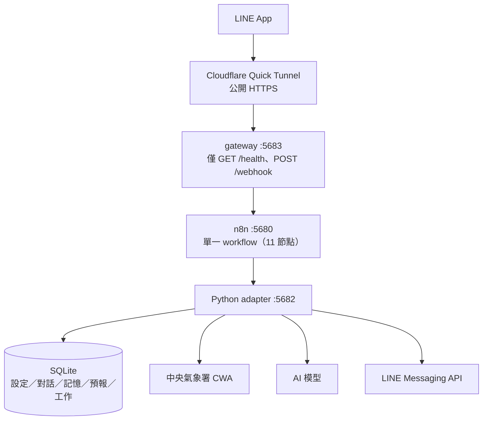

# LINE 天氣＋角色聊天機器人：專案介紹

> 我做了一個住在 LINE 裡的天氣小夥伴：它會主動整理預報、預報有變化時提醒我帶傘，也會陪我聊天、記住我的偏好。
>
> 這份文件是我自己寫的介紹，希望第一次看到這個作品的人，可以從頭到尾讀完就明白「我在做什麼、為什麼做、做到哪裡了」。

---

## 一、我為什麼會想做這個

說起來很單純，就是被淋雨淋出來的。

我每天都要查天氣，很懶，能不看就不看。結果就是早上看起來不會下雨，中午吃完飯出門就忘了帶傘，然後在路上淋雨。更慘的是，就算我早上真的有看過預報，也常常不會注意到後來預報改了什麼。

所以我後來想清楚的，不是「怎麼查到天氣」——那個 App 就有。真正的問題是：**天氣資訊沒有在對的時間、主動出現在我眼前。** 我需要的不是一個查詢工具，而是一個會自己盯著天氣、在要出門的時候跳出來提醒我的東西。

另一個原因是，我那時候剛好在玩 AI 聊天。既然本來就有個 AI 角色在線上陪我講話，那不如讓它同時是有用的：除了聊天，也幫我管天氣。這樣也比再開一個 App 自然，畢竟 LINE 是我每天都一定會打開的那個 App。

就這樣，這個作品從「懶得查天氣」開始，變成了一個會提醒我帶傘、也會記得我不喜歡被叫全名的 LINE 角色。

---

## 二、我想解決的問題

| 我遇到的麻煩 | 我做的對應設計 |
|---|---|
| 每天要自己主動查預報 | 每小時在背景抓氣象署的資料；依我設定的起床時間主動推一份晨報 |
| 出門忘記帶傘 | 預報有變化時主動通知我，點名提醒「會下雨，記得帶傘」 |
| 看過預報卻沒注意到後來變了 | 逐時段比對新舊兩版預報，而不是只看「有沒有更新」 |
| AI 聊天沒記憶，聊完就忘 | SQLite 保存長期記憶、對話摘要與偏好，可以更正也可以忘記 |
| 新手不知道從哪開始設定 | 固定的新手引導流程，一題一題問，最後我明確「確認開始」才生效 |
| 想要像 galgame 一樣點選對話 | LINE Quick Reply 按鈕，每輪附三個接話選項；同時保留自由打字 |

---

## 三、我做出來的功能

### 1. 新手引導：不用看說明書就會用

我自己加好友進去測試時，角色會依序問我，每次只問一題：

```text
你想接收哪個縣市的天氣呢？例如「臺中市」或「澎湖縣」，支援全臺22縣市。
→ 你通常幾點起床？
→ 每天起床時，要收到一份天氣晨報嗎？
→ 夜間也可以傳訊息給你嗎？（夜間為 23:30 至 05:30）
→ 最後，想讓我怎麼稱呼你、用什麼口吻陪你聊呢？（也可以說「先跳過」）
→ 請回覆「確認開始」儲存並開始聊天
```

過程中我刻意留了三個地方：

- **可以一次講完，也可以分次回答。** 已經驗證過的答案會先存成草稿，不用照順序重來。
- **資料齊全還不算完成。** 一定要我自己回「確認開始」，它才會正式寫入設定和初始偏好。
- **沒完成引導就不會聊天或推播。** 避免半套設定就開始對我亂發訊息。

對我來說，第四題最關鍵 —— 稱呼和口吻其實是這個角色最像「一個人」的地方。

### 2. 天氣預報整理與主動提醒

- 支援**全臺 22 縣市**（澎湖、金門、連江都有），資料來自中央氣象署 `F-D0047-089`。
- **每日晨報**：起床前十分鐘先準備好，到我的起床時間送出，裡面整理了天氣、氣溫、體感溫度跟降雨機率。
- **預報變更提醒**：只有「同一個時段」從無雨變有雨、或降雨機率跨過門檻才會提醒我；晴天轉陰天不吵我。晨報已經講過會下雨的時段，也不會再通知一次。
- **問了就查得到**：聊天時可以問「臺中市今天會下雨嗎」，查別的縣市不會改掉我原本設的提醒地區。
- **夜間可以選擇**：夜間提醒預設是關閉的，我開了才會在深夜推重要變化。

### 3. 個人化聊天與記憶更新

- **口吻和稱呼隨時可以改**：跟它說「叫我阿洋」「用溫柔一點的語氣」，之後的對話和隔天的晨報都會跟著變。支援的口吻是笨笨傲嬌、溫柔、元氣、淡定四種。
- **記憶會自己整理**：聊天裡自然講到的偏好（例如「朋友都叫我海鹽布丁」）會在背景被分類、存檔，而且會附上是哪一句話說的。之後它是真的會讀進去用，不是嘴上說「我記住了」而已。
- **可以更正，也可以忘記**：說錯了能改；不想被記住就告訴它「忘記這件事」，忘記會留下一個永久的游標，舊對話不會又把這件事撈回來。
- **長對話不會失控**：累積 20 輪之後，前面會自動壓縮成摘要、最近五輪保留原文，但原始訊息一則都沒刪。

### 4. Galgame 式的互動

每一則聊天訊息都會附三個 Quick Reply 按鈕，就像 galgame 的選項一樣：

```text
哼，我才不是特地等你起床的。
今天想先聊什麼？

1. 聊聊今天
2. 再陪我一下
3. 下午會下雨嗎
```

- 按下去就會直接送出對應的回覆；想自己打字也完全可以。
- 選項是 AI 依當下情境即時生出來的，不是寫死的模板。
- 選項有有效期限，點到舊選項會提示重新選 —— 而不是讓 AI 去猜「2」是什麼意思。

### 5. 一些看不見但我覺得很重要的設計

- **驗簽與 ACK**：LINE 簽章用原始 bytes 驗，先入庫、再回應、再處理聊天；失敗不會假裝成功。
- **去重**：同一個 LINE 事件重送，只會有一份工作、一次回覆。
- **期限**：聊天處理 25 秒、Reply 55 秒，逾時改用固定備援。Reply token 只能用一次，結果不明時我不會重試，也不會擅自改成要算額度的推播。
- **省 AI 成本**：沒有新版預報、也沒有值得通知的變化時，**完全不呼叫 AI**。

---

## 四、我怎麼做的：從 Python 走到 n8n

整個專案分三個階段走，每一步我都先求「可以驗證」才往前。

### 階段一：先用 Python 把業務邏輯做穩

一開始我完全沒碰視覺化工具，用 Python 把聊天、天氣、記憶、新手引導、LINE 傳送、SQLite 交易與鎖全部寫出來，連帶建立測試基準。

這階段的目的不是「最終長相」，而是讓規則有明確的定義跟可重現的測試。等真的要搬到 n8n 的時候，才有東西可以一行一行對照。

### 階段二：用 Skills ＋ MCP 轉換到 n8n

接著把「觸發、編排、執行證據」交給 n8n：用 Skills 拿到操作指引和容易踩的坑，再用 MCP 連到專用的 n8n 實例去建立、驗證、發布 workflow。

這個階段我定下一條原則：**n8n 負責編排，不負責業務。** 聊天規則、天氣判斷、記憶驗證和資料庫交易仍然由 Python 業務核心執行，n8n 透過 HTTP 呼叫 adapter 拿結果。這樣視覺化流程保持單純好讀，也避免出現兩套不一致的邏輯。

### 階段三：目前的架構



| 元件 | 負責什麼 |
|---|---|
| **n8n（單一 workflow）** | 接收與驗簽、聊天工作處理、背景排程、失敗分支與錯誤記錄 |
| **Python adapter** | 重用既有業務核心，處理天氣、聊天、記憶、outbox 與 LINE 傳送 |
| **SQLite** | 保存使用者設定、對話、記憶、預報快照與待處理工作，重開機可以接著跑 |
| **AI 模型** | 把既有天氣資料轉成人話、生成聊天與接話選項、提出記憶更新；格式和事實由程式檢查 |

單一 workflow 的節點分工：

```text
LINE Raw Webhook → Verify and Persist → Return Verified Status → Process Chat Jobs
                                  ↘ (transport error) → Adapter Unavailable 503
Recover Pending Chats（每秒） → Process Chat Jobs
Background Every Second（每秒） → Weather Outbox and Memory
Workflow Failed（Error Trigger） → Save Sanitized Failure
```

安全邊界上，`5680`（編輯／MCP／webhook）、`5681`、`5682`、`5683` 全部只綁 loopback，公開的只有 gateway 的兩條路由；adapter 的內部金鑰放在 credential，不寫進 workflow 文字。

---

## 五、我怎麼確認它真的能用

我把驗證分成幾層，各層分開記錄，不把「跑過」當成「驗收通過」。

| 層級 | 內容 | 現況 |
|---|---|---|
| Python 業務回歸 | 解析、排程、格式、去重、句數、失敗處理 | 已通過：189 案例中 186 PASS、3 項 live 標記 NOT_RUN（需明確加 `--live`） |
| adapter／生命週期隔離測試 | 路由、驗簽、期限、取消清理、隧道生命週期 | 已通過：17／17 |
| 真實 n8n 引擎＋mock 業務 | 單一 workflow 接線、22 縣市逐一設定與查詢、故障注入 | 已通過：33／33 |
| 公開 HTTPS 實測 | 空事件驗簽（正確 200／錯誤 400）、私有路由 404 | 已通過（業務端仍為 mock，未更新真實 LINE endpoint） |
| 真實 CWA／AI | 讀取實際預報、實際模型生成 | **部分通過**：T01／T02／T03／T05 通過；T04 在真實模型下曾因模型正文含非預期字元而沒過單句檢查，屬模型內容層問題（資料流程沒中斷），改用模型替身的回歸路徑已通過 |
| 手機端收訊與真實 Reply token | 實際使用的端到端體驗 | **還沒被我用真手機驗收過**，不能算通過 |

證據檔固定在 `logs/ci/latest.json`、`logs/live/latest.json`、`n8n/logs/latest.json`、`n8n/logs/service_tests.json`、`n8n/logs/public_https.json`。

我想把話說清楚：mock 通過不等於真實 LINE 業務通過，上面那兩個「還沒」就是還沒，我不會拿別的層級的成績來蓋。

更細的測試範圍與證據位置，見 [使用與驗證](../n8n/docs/使用與驗證.md)。

---

## 六、我接下來想做的：完整的聊天情緒系統

現在的角色已經有「口吻設定」和「偏好記憶」，但**情緒分數這塊還沒實作**。這是我下一階段最想做的事：

1. **讓 AI 判斷每一輪互動的影響**：由 AI 評估這句話對角色情緒是加分還是減分。
2. **累積成分數**：每位使用者各自累加，形成一個持續變動的情緒值。
3. **反映到後續表達**：語氣、用詞、回應方式隨分數改變，讓對話有連續性和角色感，而不是「每次都客氣有禮」。
4. **邊界要守住**：情緒只影響表達方式，不改變任務範圍與工具權限。

做到之後，「你今天怎麼樣」就不會再是一句固定回覆，而是真的會隨我們之間的累積而改變的角色反應。

---

## 七、你想試試看的話

```powershell
# 1. 安裝依賴
uv sync --locked --group dev

# 2. 準備環境變數（已有 .env 就保留原檔，只補齊設定）
Copy-Item .env.example .env

# 3. 啟動 n8n 常駐服務（正式模式）
uv run python n8n/service.py
```

啟動後在 LINE Developers 開啟 **Use webhook**，就可以拿手機實測。編輯介面在 <http://127.0.0.1:5680>，服務狀態看 `n8n/.runtime/service.json`。

不想碰到正式資料的話：

```powershell
uv run python n8n/service.py --mock   # 不建隧道、不更新 LINE endpoint
```

---

## 八、相關文件

| 文件 | 內容 |
|---|---|
| [根目錄 README](../README.md) | 專案總覽、功能表與執行方式 |
| [n8n README](../n8n/README.md) | 目前主要服務入口與環境需求 |
| [使用與驗證](../n8n/docs/使用與驗證.md) | 啟停、切換、測試分層與證據位置 |
| [實作轉換分析](../n8n/docs/實作轉換分析.md) | 單一 workflow 的節點、資料流與執行邊界 |
| [縣市預報與設定](../n8n/docs/縣市預報與設定.md) | 22 縣市查詢與提醒地區的規則 |
| [Python 初版架構與驗證](實作架構與驗證.md) | Python 階段的檔案配置與業務契約 |
| [原始計畫](LINE_Weather_Galgame_Bot_Plan.md) | 一開始的完整需求與驗收規格 |
