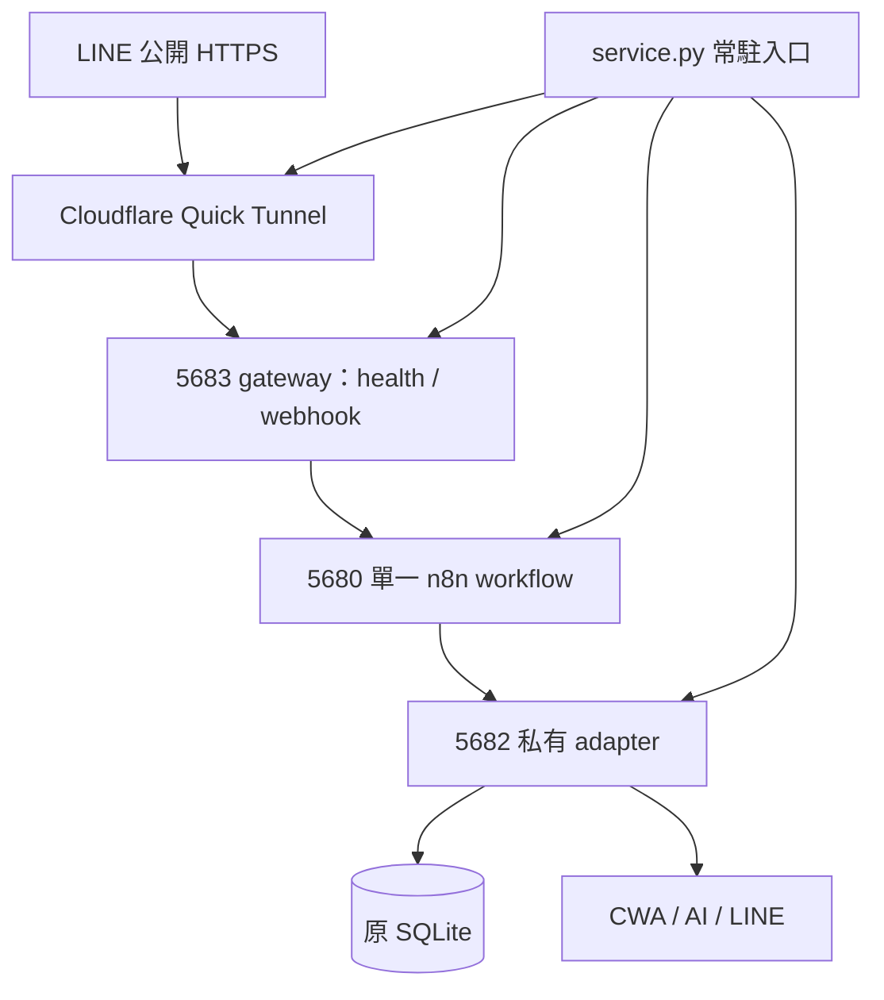
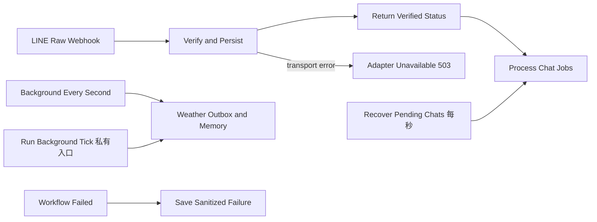

# 單一 n8n workflow 實作分析

## 替代範圍與資料流

`n8n/service.py` 接替原 `weather_bot.main` 入口，一次管理 n8n、業務 adapter、公開 gateway、Quick Tunnel、LINE endpoint 同步與停止。收件、聊天補跑、背景與錯誤處理都在一個 workflow。

這是功能上的服務替代，仍保留 Python adapter。既有聊天、天氣、記憶及 SQLite 交易未重寫成第二套節點，不啟動原 HTTP 主程式及輪詢 worker。Workflow JSON 仍需搭配 adapter。

5680 editor／MCP／本機 webhook、5681 runner broker、5682 adapter、5683 gateway 全部綁定 loopback，只有 gateway 兩條路由經 tunnel 公開。正式啟動先檢查 18567，仍占用就拒絕，避免共同領取正式工作。

私有 adapter 除 health 外都需要隨機內部 key；key 在 `.runtime/internal-key.json`，透過 n8n Header Auth credential 傳入，沒有寫入 workflow 原碼。公開 gateway 不將 key 放進 n8n Webhook input，只附收件時間與 HMAC 證明。

## 唯一 workflow：11 節點

| 節點 | 行為 |
|---|---|
| LINE Raw Webhook | 保留原始 binary body |
| Verify and Persist | 轉送 bytes、簽章及收件證明；驗證後入庫，事件 ID 去重 |
| Return Verified Status | 回 adapter 的 200／400／413，先完成 ACK |
| Process Chat Jobs | ACK 後領取及等待聊天工作；Reply 不重試 |
| Adapter Unavailable | 入庫 transport error 回 503 |
| Recover Pending Chats | 每秒補跑已入庫但未完成的聊天 |
| Background Every Second | 正式每秒驅動背景；mock 暫停，測試明確觸發 |
| Weather Outbox and Memory | 天氣、晨報、outbox、記憶；鎖占用時回 busy，避免堆積 |
| Run Background Tick | 有 Header Auth 的本機測試入口；gateway 不提供 |
| Workflow Failed | 同一 workflow 的 Error Trigger |
| Save Sanitized Failure | 僅 workflow ID、execution ID、node，最多最新 100 筆 |

沒有跨流程的 Execute Workflow 或外部 Error Workflow。核對安裝的 n8n 2.35.7 執行邏輯並注入故障：未指定其他錯誤 workflow 時，production failure 會觸發本 workflow 的 Error Trigger；error mode 不再遞迴。

舊三個 workflow 已停用及封存，沒有刪資料；`logs/migration.json` 保存對應。新 ID 與 editor URL 在 `workflows/manifest.json`。

## 原始 bytes、工作與期限

Gateway 在讀 body 前記錄時間，以內部 key 簽署 `timestamp + newline + 原始 bytes`。Adapter 先驗 LINE 簽章，再驗收件證明，拒絕偽造、非有限及未來時間。25 秒聊天及 55 秒 Reply 期限涵蓋 gateway 到 n8n 的排隊，不從 adapter 收到時重新起算。

Webhook 開啟 rawBody，HTTP Request 使用 binary data，不重新 JSON 序列化，保留 Unicode、縮排與空白。公開／私有入口上限 1 MiB。既有 `line:<webhookEventId>` 保證四個並行重送只產生一份工作及一次回覆。

`Bot.start(workers=False)` 只做初始化、DB 恢復及依賴管理，不建立舊輪詢 task。n8n 呼叫 `/jobs/chats` 與 `/jobs/background`。聊天只在領取及取得 task 快照時持有 dispatch lock，實際等待在鎖外，原使用者鎖保留。背景使用另一把鎖，慢速記憶不阻塞聊天。

| 原始模組 | 保留行為 |
|---|---|
| controller／onboarding | 引導草稿、逐字來源偏好、明確確認、選項期限、範圍限制 |
| chat／schemas | 一則文字、三個接話選項、句數及有效天氣事實 |
| ai／ai_summary | 原 AIClient、JSON Schema、完成狀態、thinking 控制、備援 |
| weather | 行政區、有效時間、快取、晴雨變化及提醒去重 |
| memory | 使用者隔離、來源 ID、scope、版本、到期、忘記、壓縮游標 |
| workers | 晨報、配額、outbox、背景記憶，由 n8n 每秒驅動 |
| db | 原七張表、短交易、去重、重啟恢復 |
| line_io | Reply 單次使用，結果不明不重試／不轉 Push；Push retry key |

不改 schema，不新增 workflow static data 聊天狀態。正式沿用原 DB，mock 使用 `.runtime/mock_bot.sqlite3`。每案 evidence 在單一 transaction 讀取，避免跨表讀到不同時刻。

入庫及背景 HTTP 有限重試，由事件鍵、outbox 狀態及 Push retry key 去重。內部 HTTP 使用 keep-alive、Uvicorn keep-alive timeout 30 秒，Python 到 n8n 閒置連線 2 秒回收。曾重現 Windows 本機 Node Axios 在 Connection: close 的間歇 ECONNRESET；改 keep-alive 後直接連線對照及完整業務測試通過，沒有放寬斷言。

## 常駐、恢復與停止

ServiceLock 使用 Windows 檔案鎖防重複啟動；5682／5683 exclusive bind，不以裸 TCP 探測干擾 HTTP server。NodeRuntime 只接管 `.runtime/instance.json` 記錄且 command line 符合 n8n 的 5680 PID。新程序使用專用 user folder、5680／5681、Asia/Taipei，停用診斷及更新提示。

本地 REST 初始化帳號及 Header credential；workflow 查詢、建立、更新、發布、驗證、執行及 pin-data 測試走官方 instance MCP。連續兩次 n8n 探測失敗後，暫停公開 readiness、停止 tunnel、恢復同一份 n8n DB、MCP 發布同一 workflow，再重建及同步 HTTPS。已以真實子程序終止測試恢復。

停止依序關閉 tunnel、停用流程、等待 gateway／adapter、回收 n8n 程序樹。清理 task 使用 shield，取消訊號落在 finally 仍等清理完成。已開始的 MCP thread 不能直接取消，因此先等待設定完成並取得 workflow ID，再清理停用。這兩種競態均有回歸測試。

這是單機單 adapter；adapter 故障會整體清理並標記 failed，需要重跑相同入口。未加入多 worker、遠端部署、Windows Service 或開機排程。

## HTTPS 與 mock 邊界

N8nTunnel 沿用原 LocalTunnel 的公開健康、正誤簽章探測及 LINE endpoint 測試／更新／確認，改接只公開兩條路由的 gateway。Windows 使用 Popen、非同步 thread 及 Selector event loop。隧道退出回收 child 後重建 URL，每個新 URL 都重新驗證；不公開 editor／MCP。

Mock 保留真正 AIClient、WeatherService、LineSender，只替換 MockTransport；未知 host／路由直接失敗。固定 CWA fixture 仍走原解析，假 LINE 檢查 token 單次使用、60 秒上限及 Push retry key。Mock 管理路由只在 mock app 註冊且要求內部 key。

測試含 28 案業務、17 案服務／隧道及程序恢復。另建立真實 HTTPS，測空事件正確簽章 200、錯誤簽章 400、私有路由 404；仍是 mock 業務，不呼叫 LINE endpoint 更新 API，探測 URL 結束時停止。

本次沒有切換原正式服務或 LINE endpoint。真實模型語意、CWA／LINE、手機收訊、長時間負載及最終網路 SLA 仍需真實驗收。Quick Tunnel 非固定網址且無 SLA，見 [Cloudflare 官方說明](https://developers.cloudflare.com/tunnel/get-started/quick-tunnels/)。

## MCP、skills 與證據

套用 using-n8n-mcp-skills、n8n-mcp-tools-expert、workflow-patterns、node-configuration、expression-syntax、error-handling、validation-expert，參考 binary、agent、subworkflow、多實例指引。官方 MCP 與 community 工具名稱不同，以實例 schema 為準；沒有 Code node 或額外 AI Agent 迴圈。

`build_workflows.py` 保存節點／SDK 驗證並回讀接線；`finalize.py` 匯出唯一 workflow、來源雜湊、execution 中繼資料與約束。原 Python 模組未修改。新增程式、文件、mock 與證據都在 `n8n/`，帳號、key、token 僅存於忽略版控的 `.runtime/`。
